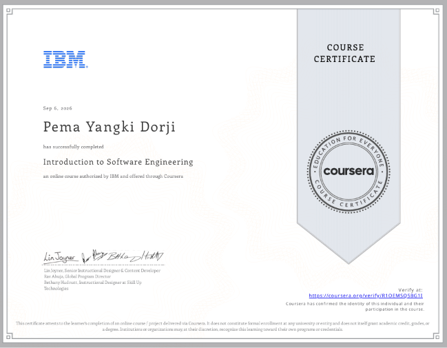
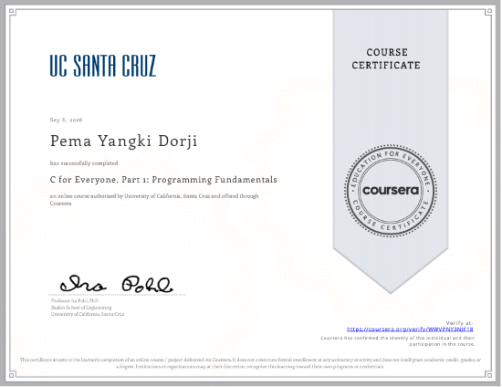
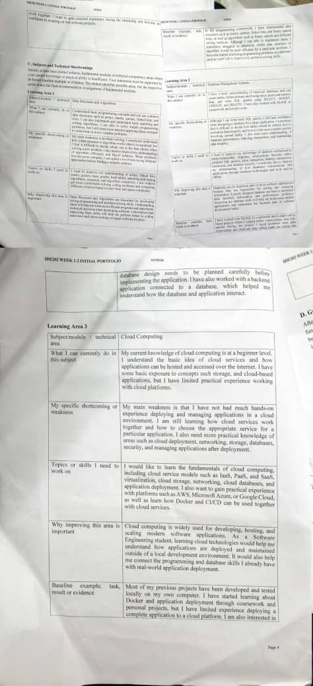

# Evidence – Weeks 1 to 4

## E1: Software Engineering Fundamentals – Course Completion Certificate

## E2: C Programming – Course Completion Certificate

## E3: C Programming – Practice in Visual Studio

## E4: Portfolio Form – Draft Version

Note: Submitted to my guide the draft in hardcopy; this is the digital draft used to prepare the submission.