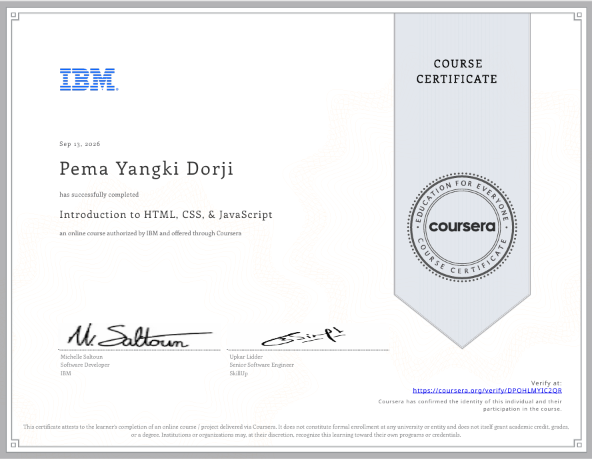
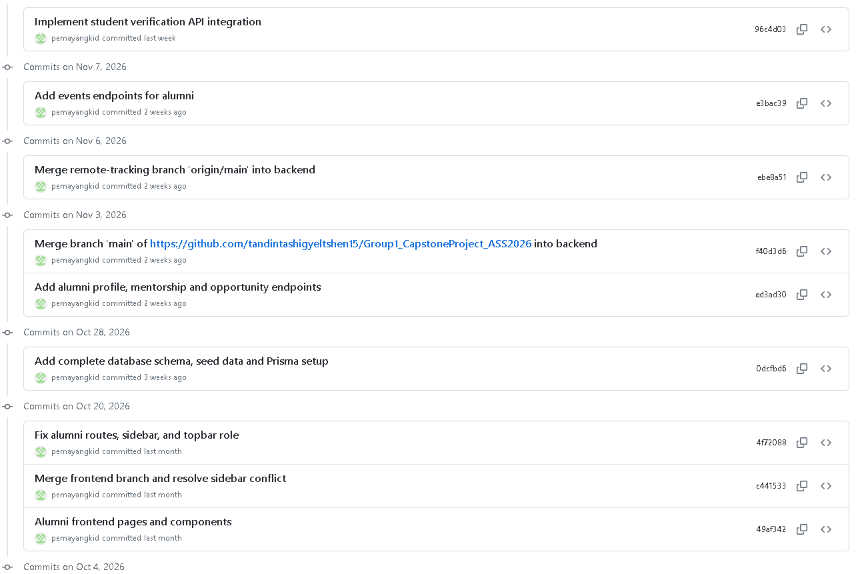
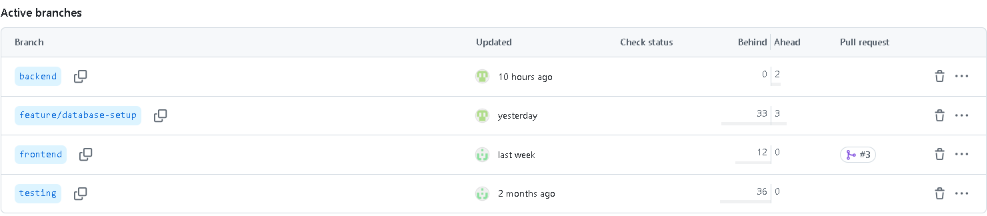
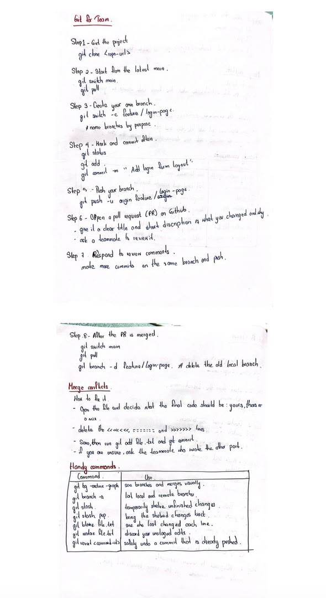
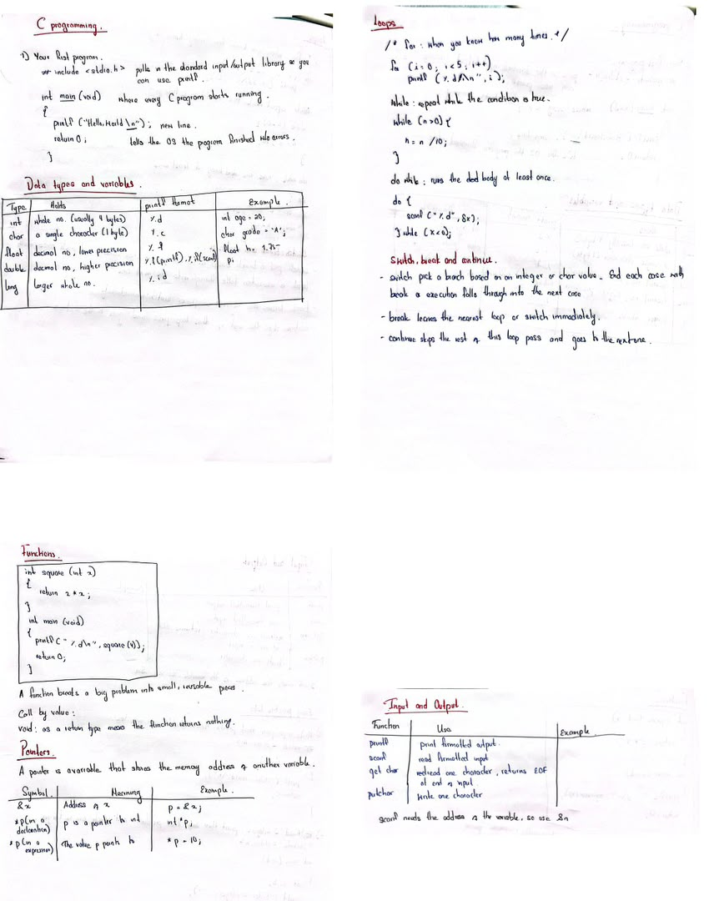
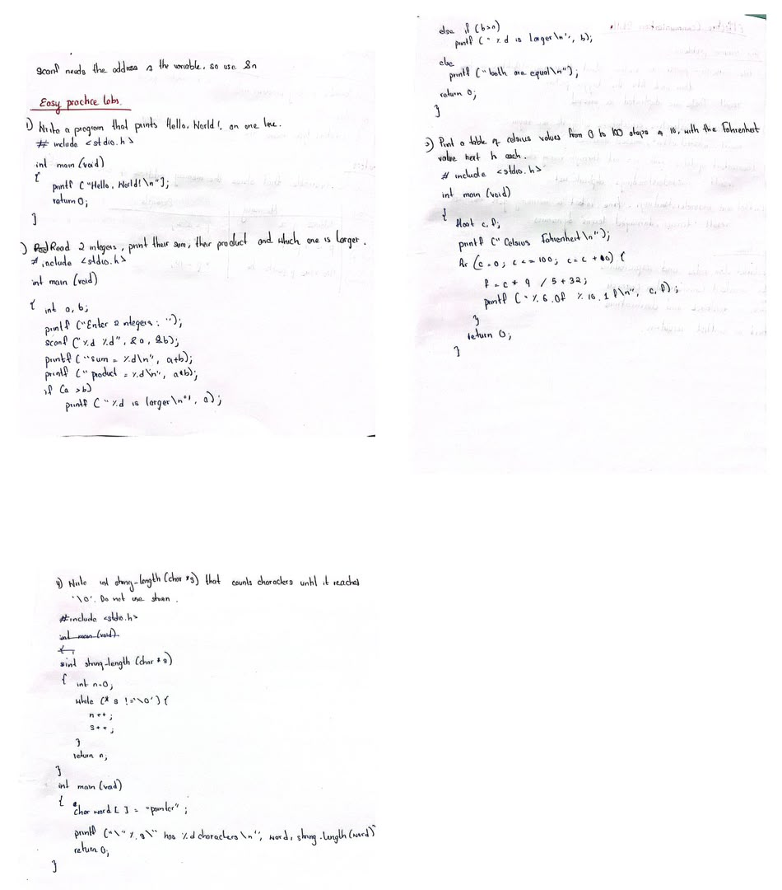

# Evidence – Weeks 5 to 8

## E1: HTML, CSS and JavaScript – Course Completion Certificate

Note: IBM Introduction to HTML, CSS, & JavaScript on Coursera, completed after the meeting.

## E2: HTML, CSS and JavaScript – Notebook Notes

Note: Handwritten notes I made while completing the course.

## E3: HTML, CSS and JavaScript – Lab Exercise Practice

Note: Screenshot of a lab exercise I completed in the course.

## E4: Git and GitHub – Commit History

Note: My commits on the CST Alumni Portal repository, filtered by my name. Repository link: [CST Alumni Portal](https://github.com/tandintashigyeltshen15/Group1_CapstoneProject_ASS2026)

## E5: Git and GitHub – Branches

## E6: Git – YouTube Tutorial and Branch Workflow

Note: The tutorial I used to learn the basic Git workflow.

Note: Branches in the CST Alumni Portal repository.

## E7: C Programming – Notebook Notes

Note: Notes on functions, pointers and recursion made while reading the library books.

## E8: C Programming – Handwritten Lab Practice

## E9: C Programming – Library Books

Note: Books borrowed from the library: [The C Programming Language, by Brian W. Kernighan and Dennis M. Ritchie].
