# Evidence – Weeks 9 to 12

## E1: ERD for the CST Alumni Portal – Submitted Version
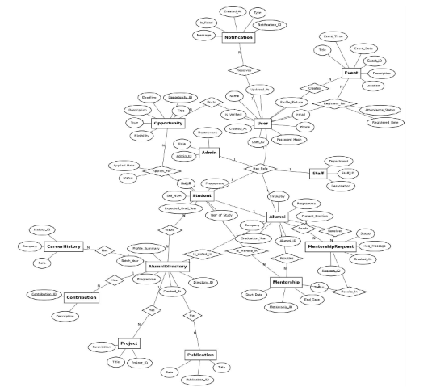

Note: The ERD our group prepared and submitted, showing entities, attributes, relationships and cardinalities. This is group work.

## E2: Database Design Revision Class – Notes

Note: My notes from the revision class our faculty guide conducted before we submitted the ERD.

## E3: Relational Design – Tables, Primary Keys and Foreign Keys
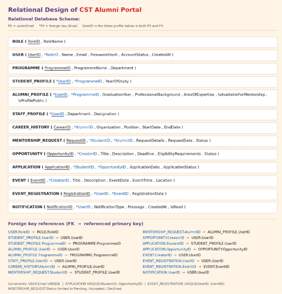

Note: The relational design our group prepared from the ERD.

## E4: Relational Databases – Course Completion Certificate
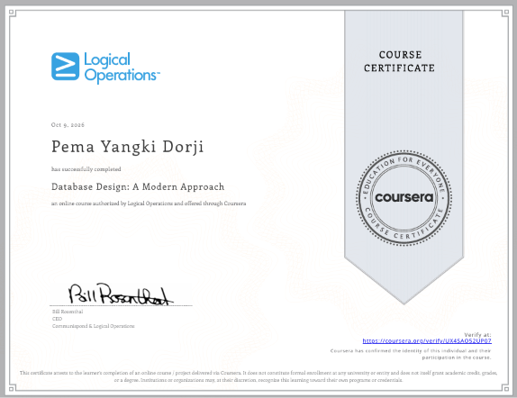

Note: IBM Introduction to Relational Databases (RDBMS) on Coursera. This shows course completion only.

## E5: Frontend Development – Branches
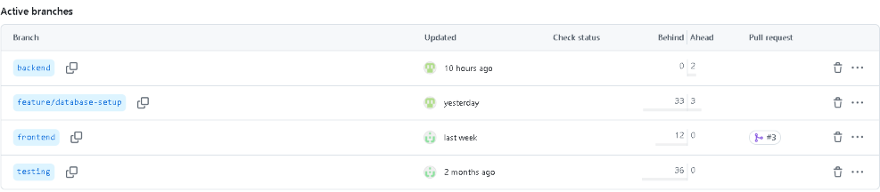

Note: Separate branches for the frontend features, so unfinished work stays out of main.

## E6: Frontend Development – My Commit History
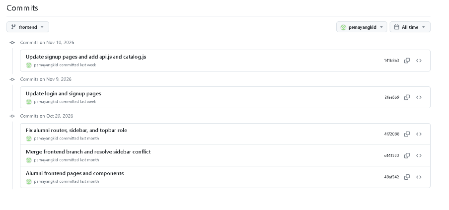

Note: My commits for my frontend features, filtered by my name.

## E7: My Notes of the Feedback Points
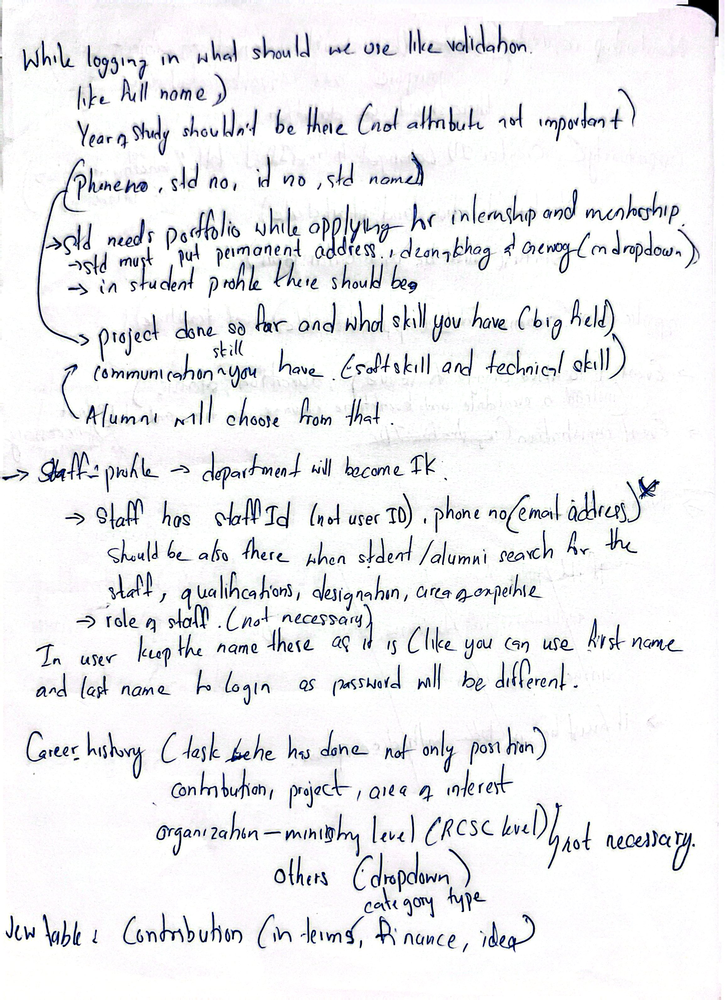

Note: My notes of the feedback points.

## E8: Revised Relational Design
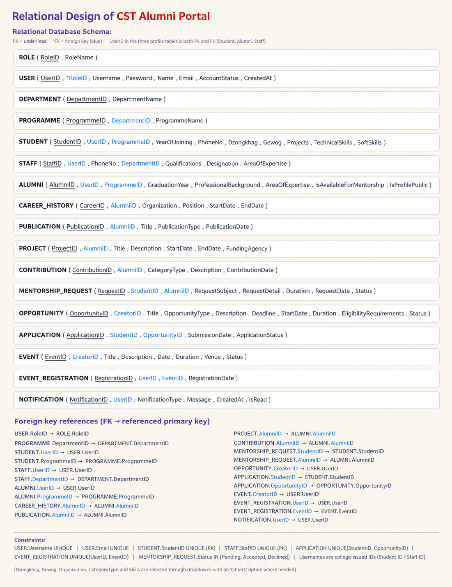

Note: The relational design after the guide's feedback.

## E9: Database Branch – My Commit History
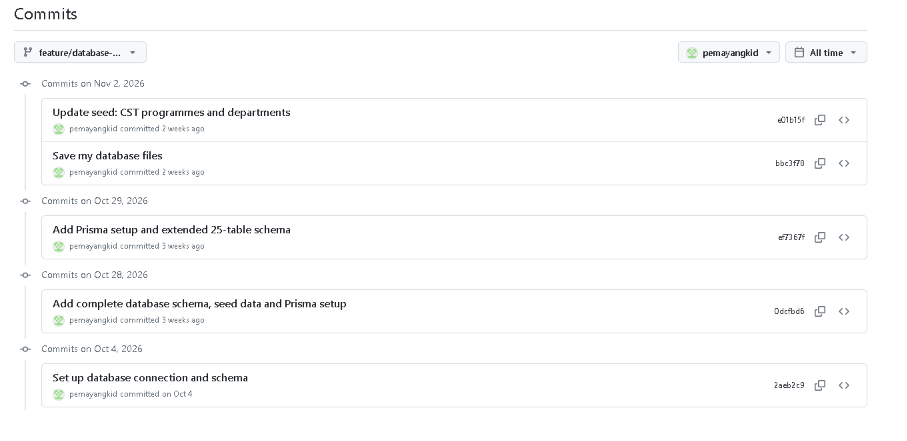

Note: My commits on feature/database-setup, filtered by my name. Teammates made later changes after the backend and frontend were developed.

## E10: Backend – My Commit History
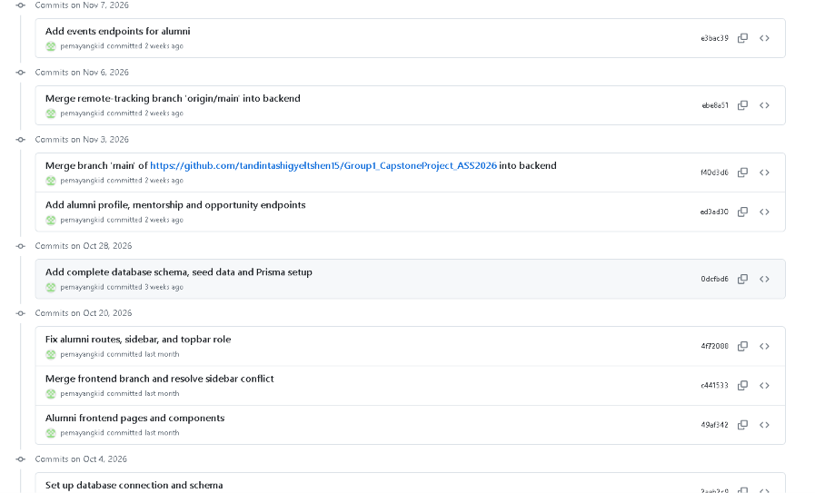

Note: My commits for the alumni backend, filtered by my name.

## E11: Postman – Alumni API Tests
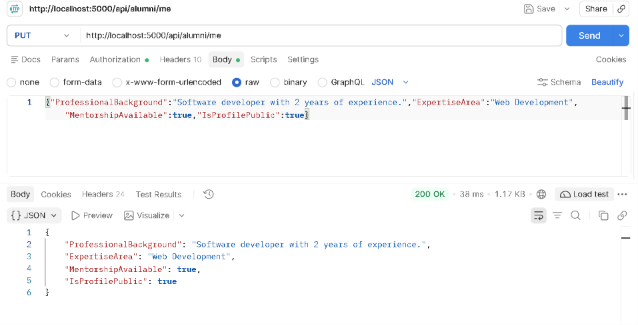

Note: Requests and responses I tested for the alumni role.

## E12: Postman – Staff API Tests
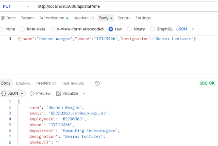

Note: Requests and responses I tested for the staff role. I have not tested the other roles yet.

## E13: Git – YouTube Tutorial and Branch Workflow
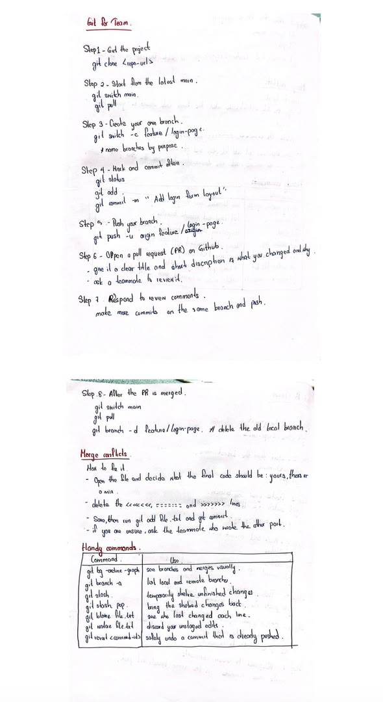

Note: The tutorial I used to learn the basic Git workflow.

## E14: Effective Communication – Certificate
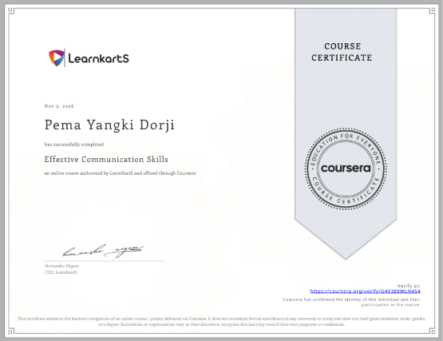

Note: Coursera Effective Communication Skills course. This shows course completion only.

## E15: Effective Communication – My Notes
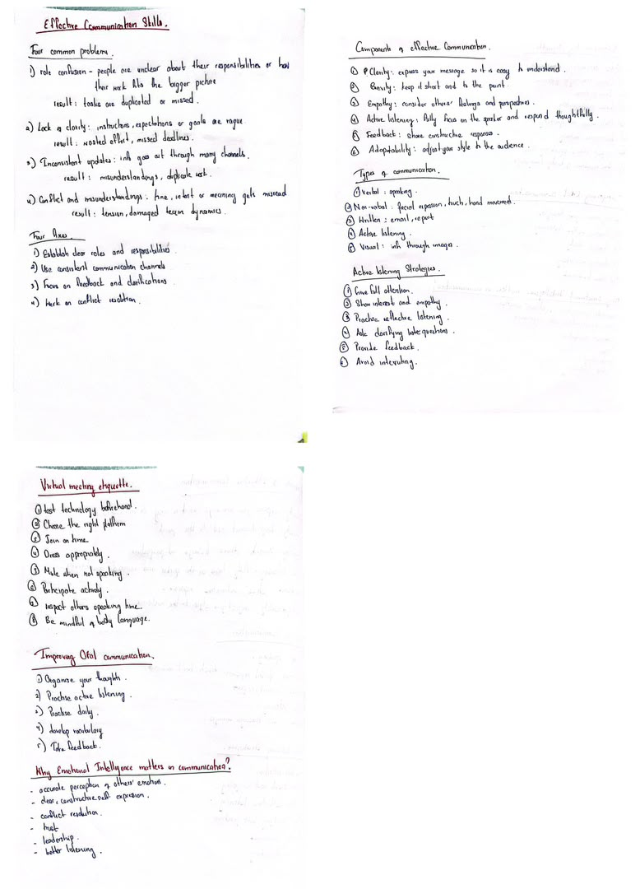

Note: My notes on the five modules: foundations, active listening, verbal and non-verbal communication, the 7 Cs, and emotional intelligence.